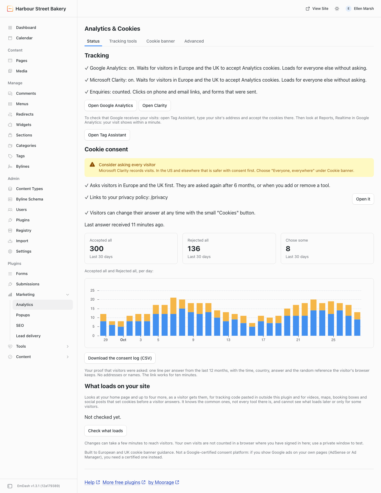
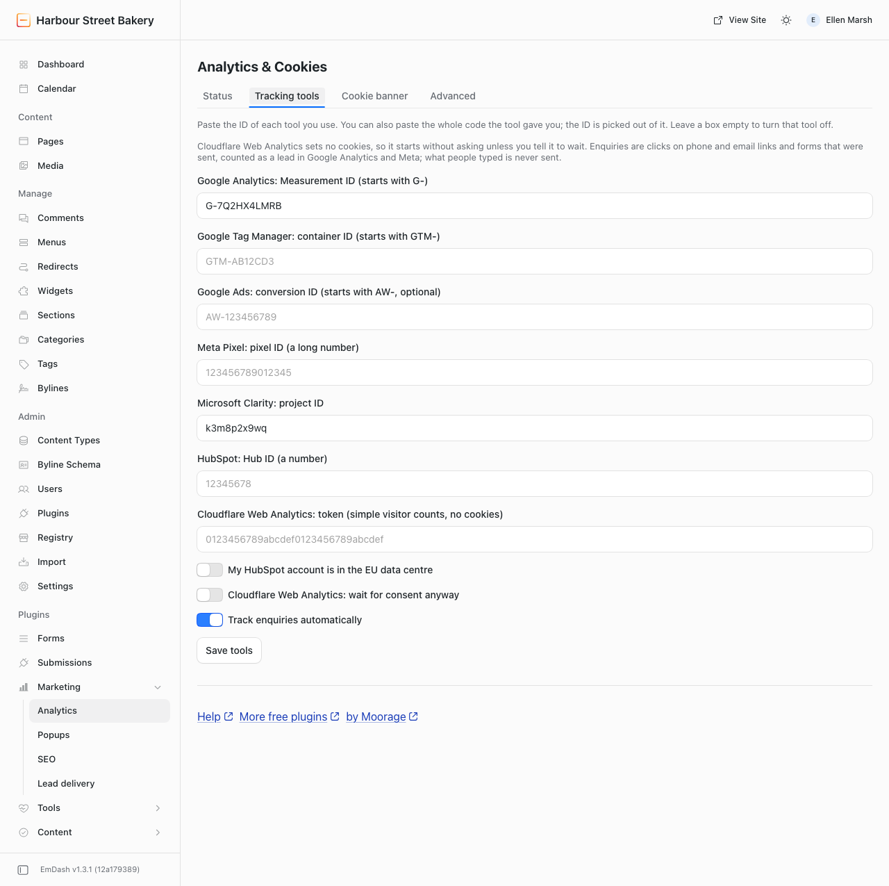
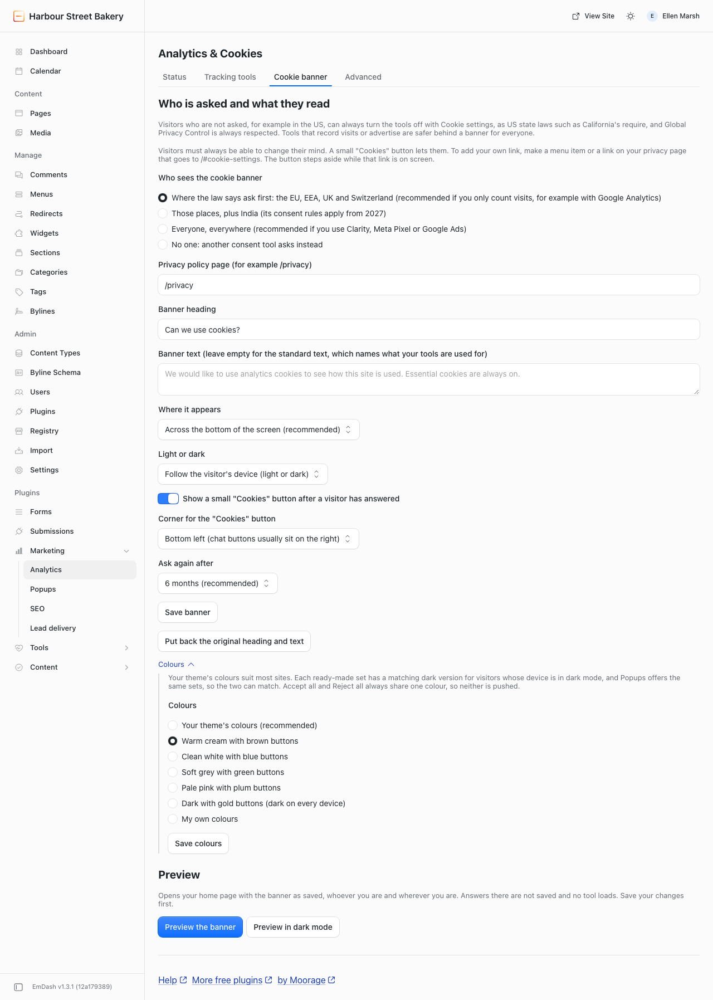
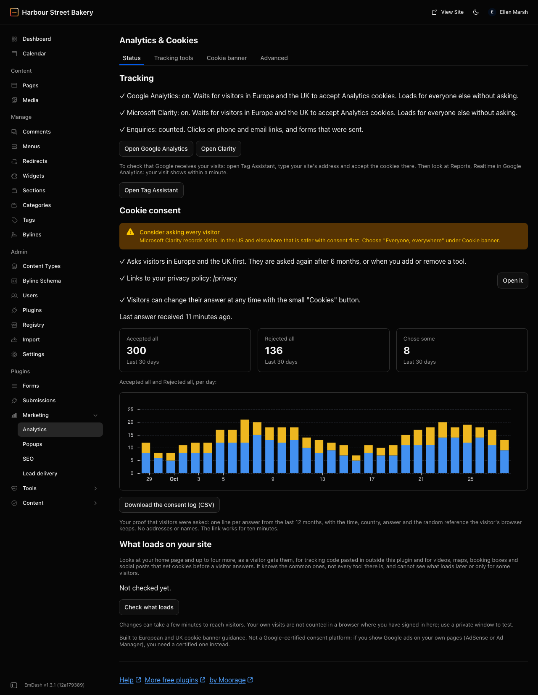
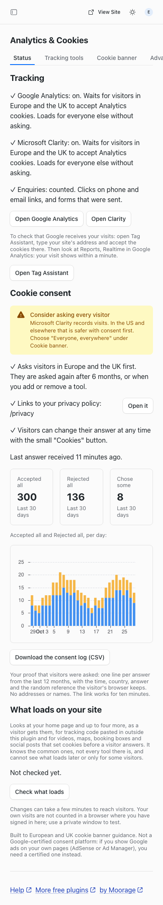

# @moorage/plugin-analytics

Analytics & Cookie Consent for [EmDash](https://emdashcms.com): add Google Analytics, Google Tag Manager, Google Ads, Meta Pixel, Microsoft Clarity, HubSpot and Cloudflare Web Analytics by pasting one ID each, with a cookie banner that holds every one of them back until the visitor agrees. Tools and banner live in one plugin, so "nothing loads before consent" is true by construction, and there is no theme file to edit. Runs on any EmDash site, self-hosted or on Cloudflare, with no account and no key.



## What it does

- **Tracking tools.** One box per tool. Paste the ID, or the whole code the tool gave you; the ID is picked out of it. A wrong ID is explained ("That is a Google Tag Manager ID (GTM-). Put it in the Google Tag Manager box instead."). An empty box means off.
- **Cookie banner.** A sheet across the bottom of the screen (or a box in a corner) that asks "Can we use cookies?" and says what each kind is for. Accept all and Reject all look exactly the same, so no answer is pushed; a quieter Choose opens a panel where Essential is always on and Analytics and Marketing are switches, off until the visitor turns them on, with the tools listed under each. On a phone it takes about a quarter of the screen. It does not dim or block the page, works from the keyboard, follows light and dark, and never moves the page. It takes your theme's colours and fonts when you set them (see below), one of five ready-made colour sets (the same as in Popups, so the two match), or three colours of your own.
- **Nothing before consent.** No script from any tracking company is requested until the visitor allows its category. Google tags get Consent Mode v2 signals (all four denied by default, updated on the answer). Clarity and HubSpot get the visitor's answer through their own consent settings. There are no `<noscript>` pixels.
- **Changing your mind.** After an answer, a small "Cookies" button stays in the bottom left corner (or right, if a chat button lives on the left) and reopens the panel. Any link to `/#cookie-settings` does the same, such as a "Cookie settings" item in your footer menu or a link on your privacy page; no code is needed, and while such a link is on screen the small button steps aside. Taking consent back tells the tools, deletes their cookies and reloads the page without them.
- **Who is asked.** Where the law says ask first, the EU, EEA, UK and Switzerland (the default, right for sites that only count visits); those places plus India (its consent rules apply from about May 2027); everyone, everywhere (recommended with Clarity, Meta Pixel or Google Ads, which record visits or advertise); or no one, when another consent tool asks instead. Visitors who are not asked, for example in the US, can always turn the tools off with Cookie settings, as US state laws such as California's require, and Global Privacy Control is always respected. The admin says this beside each choice, and the Status tab suggests asking everyone when you use those tools.
- **Enquiries.** Clicks on phone and email links, and forms sent through the official forms plugin, are counted as a lead (`generate_lead` in Google Analytics, `Lead` or `Contact` in Meta, an `enquiry` event in the data layer). Only the kind of enquiry is sent, never a number, an address or anything typed into a form.
- **Never tracked.** The admin, preview links, the visual editor, a browser that has signed in to the admin, and any pages you list.

| Tracking tools                                     | Cookie banner, with its colour sets               | Status, dark mode                         | Status, phone                            |
| -------------------------------------------------- | ------------------------------------------------- | ----------------------------------------- | ---------------------------------------- |
|  |  |  |  |

## What it does not do

- It is **not a Google-certified consent platform and has no IAB TCF support.** That only matters if you _show_ Google ads on your own pages (AdSense, Ad Manager); those sites need a certified tool. Measuring your own Google Ads campaigns works.
- It does not make a site "GDPR compliant" by being installed. The banner is built to the EDPB cookie banner taskforce report and the UK ICO's guidance; what your tools do with the data is still yours to describe in your privacy policy.
- No dashboards or reports: read your numbers in each tool (the Status tab links to each one).
- No cookie scanner that claims to find everything, no cookie wall, no consent by scrolling. "Check what loads" looks for the common problems only (see below).
- Not yet: custom code snippets, banner text per language.

## Install

This is a native plugin: it is added by a developer in the site's code, not from the plugin registry.

```sh
pnpm add @moorage/plugin-analytics
```

```js
// astro.config.mjs
import { analyticsPlugin } from "@moorage/plugin-analytics";
import emdash from "emdash/astro";

export default defineConfig({
	integrations: [emdash({ plugins: [analyticsPlugin()] })],
});
```

Needs EmDash 1.2.0 or later. There are no options; everything is set on the admin page.

### What your theme must render

The plugin adds one inline script to the page head and nothing else. Your layout must render EmDash's head component, as every EmDash template already does:

```astro
---
import { createPublicPageContext } from "emdash/page";
import { EmDashHead } from "emdash/ui";

const page = createPublicPageContext({ Astro, kind: "custom", pageType: "website", title });
---

<head>
	<title>{title}</title>
	<EmDashHead page={page} />
</head>
```

Only the `head` placement is used. `EmDashBodyStart` and `EmDashBodyEnd` are not needed by this plugin. The banner is built by the script inside a shadow root, so your theme's styles do not change it and it does not change your theme.

To put a "Cookie settings" link in your footer, no theme change is needed: in the admin, under Menus, add a custom link to your footer menu with the URL `/#cookie-settings`. Any link to `/#cookie-settings` or `#cookie-settings`, in a menu or in a page's text, opens the cookie choices on any page, and the floating "Cookies" button steps aside while it is on screen. Themes that mark a link or button with `data-cookie-settings` keep working the same way.

### Matching your theme

The banner takes these CSS variables from your page when you set them; they reach into its shadow root. Values with `light-dark()` follow your theme's light and dark mode.

```css
:root {
	--cookie-consent-background: #fcfcf9;
	--cookie-consent-text: #16202a;
	--cookie-consent-accent: #a0185a; /* both Accept all and Reject all */
	--cookie-consent-accent-text: #ffffff; /* text on those buttons: keep it readable */
	--cookie-consent-rule: #16202a; /* the line above the banner, and its edges */
	--cookie-consent-surface: #f2e9cf; /* the banner itself; by default the background, a shade darker */
	--cookie-consent-shadow: 0 -12px 32px -16px rgb(0 0 0 / 0.28); /* "none" for no shadow */
	--cookie-consent-font: "Public Sans", system-ui, sans-serif;
	--cookie-consent-heading-font: "Newsreader", Georgia, serif;
	--cookie-consent-width: 1280px; /* the banner's content lines up with your page */
}
```

A colour set or your own colours chosen on the Cookie banner tab win over these (their dark versions follow the visitor's device; a theme with its own light and dark switch is better served by these variables). There is no way to style Accept all and Reject all differently, on purpose.

### Content Security Policy

EmDash does not add a nonce or hash to scripts that plugins put on the page. If your site sends a `Content-Security-Policy` header, it has to allow:

- inline scripts (`script-src 'unsafe-inline'`, or a hash you maintain yourself, which changes whenever a setting changes), and inline styles for the banner (`style-src 'unsafe-inline'`);
- the hosts of the tools you switch on, in `script-src` and `connect-src`: `www.googletagmanager.com` and `*.google-analytics.com` (Google), `connect.facebook.net` and `www.facebook.com` (Meta), `www.clarity.ms` and `*.clarity.ms` (Clarity), `js.hs-scripts.com` or `js-eu1.hs-scripts.com` plus the HubSpot hosts that script loads, `static.cloudflareinsights.com` and `cloudflareinsights.com` (Cloudflare).

## The Analytics page

One page, **Analytics & Cookies** (labelled Analytics under Marketing in the admin sidebar), with four tabs.

- **Status**: three short sections, each with its warnings first.
  - **Tracking**: a tick and one line per tool saying what it waits for ("Google Analytics: on. Waits for visitors in Europe and the UK to accept Analytics cookies."), with a link to each tool's own numbers (Microsoft Clarity straight to your project; the others to their home page). With a Google tool, a link to Google's Tag Assistant and a tip to check Realtime in Google Analytics.
  - **Cookie consent**: who is asked, your privacy policy link, when the last answer came in ("Last answer received 12 minutes ago"), the last 30 days' answers as numbers and a chart, and **Download the consent log (CSV)**: one line per answer from the last 12 months (time in UTC, country, answer, Analytics and Marketing yes or no, banner version, and the random reference the visitor's browser keeps in its cookie), newest first, up to 10,000 lines. The link is signed for the admin who opened the page and works for ten minutes.
  - **What loads on your site**: **Check what loads** fetches your home page and up to four more (from its links, then the sitemap), as a visitor gets them, and lists what it finds with a plain fix for each: tracking code pasted in outside this plugin (the same tool twice, which counts every visit twice, or another tool such as Hotjar, or Google AdSense), and embeds that set cookies before the visitor answers (YouTube: use youtube-nocookie.com; Vimeo without `dnt=1`; Google Maps; Calendly; Facebook, Instagram, TikTok and X posts; Typeform; Spotify; SoundCloud; Disqus; common chat boxes). It checks against that short list, never runs the pages' scripts, and only fetches your own address; pages may be cached for a few minutes. If the site cannot call its own address from the server, it says so. The result and the time it ran stay on the Status tab.
- **Tracking tools**: the seven ID boxes, "My HubSpot account is in the EU data centre", "Cloudflare Web Analytics: wait for consent anyway", and "Track enquiries automatically".
- **Cookie banner**: who sees it, your privacy policy page, the heading and text (leave the text empty for the standard wording, which names what your tools are used for), where it appears, light or dark, the "Cookies" button and its corner, and whether to ask again after 6 or 12 months, saved with **Save banner**. Under **Colours**, folded away with its own **Save colours**: your theme's colours (recommended), one of five ready-made sets (Warm cream with brown buttons, Clean white with blue buttons, Soft grey with green buttons, Pale pink with plum buttons, Dark with gold buttons), each with a matching dark version and the same as in Popups, or **My own colours**: three colours (background, text, buttons; a combination that is hard to read is refused, and button text is chosen for you), and three more for dark mode, left empty to use the same ones. Two buttons, **Preview the banner** and **Preview in dark mode**, open your home page with the banner shown as saved: to you, wherever you are, with nothing saved and no tool loaded.
- **Advanced**: pages not to track (one address per line; everything under it is covered), and when Google Tag Manager loads.

Admins can change settings. Editors see the Status tab, read-only: no download link and no Check what loads button, but the last check's result.

**Changes can take a few minutes to reach visitors.** The script is part of the page, and pages are cached. A new setting shows when the cached copy of a page expires or the page is published again. There is no way for a plugin to clear the cache.

## How consent is decided

Everything is decided in the visitor's browser, because the same cached page is sent to everyone.

1. A saved answer for the current list of tools, not older than 6 months (or 12), is followed.
2. Otherwise, a visitor who must be asked gets the banner and nothing loads. With "Visitors in Europe and the UK", that means the EU and EEA countries, the UK and Switzerland; "Europe, the UK and India" adds India. The country comes from Cloudflare when the site runs there (a small route on your own site reads it from the request; nothing is looked up and no outside service is called). When the country is unknown, the browser's time zone decides, and when that is unknown too the visitor is asked.
3. Everyone else is not asked: the tools load when the browser is idle. They can still open the "Cookies" button, or your Cookie settings link, and say no.
4. A browser that sends Global Privacy Control never gets Marketing tools, whatever was clicked. The panel says so.

Adding or removing a tool asks everyone again, because they agreed to a different list. Changing an ID or the banner text does not.

| Category  | Tools                                                                         |
| --------- | ----------------------------------------------------------------------------- |
| Analytics | Google Analytics, Microsoft Clarity, Cloudflare Web Analytics if told to wait |
| Marketing | Google Ads, Meta Pixel, HubSpot                                               |
| Either    | Google Tag Manager: it loads once the visitor accepts at least one category   |

Google Tag Manager is a container. This plugin tells it the answer (Consent Mode signals and a `cookie_consent_update` event with `analytics` and `marketing` set to true or false, both in the data layer before the container starts); the tags inside must be set up to respect it. Cloudflare Web Analytics sets no cookies and starts without asking unless you turn on "wait for consent anyway".

## What is stored

In the visitor's browser:

- a cookie `cookie_consent` with the answer (which categories, the day, a random reference, and a code for the tool list), kept 6 or 12 months;
- `cookie_consent_geo` in local storage: the two-letter country and the day it was learned, kept 30 days.

On your site, one row per answer: the random reference, the time, the answer, the code for the tool list, and the country. **No IP address, no browser details, nothing that identifies a person.** Rows are deleted after 12 months by a daily job. The route that writes them is public, so it accepts only that exact shape, only for the banner that is live, and at most 2,000 rows a day. The consent log download holds exactly these rows, nothing more. The last "Check what loads" result is kept too: the pages checked, what was found, and when.

## FAQ

- **Is it free?** Yes, on any number of sites, your own or your clients', with no account and no key. It is open source under the MIT License: you may use, change, copy and share the code, in paid work too, as long as the copyright notice stays with it.
- **I accepted the banner but my visit does not show in Google Analytics.** A browser that has signed in to the EmDash admin is treated as staff and never tracked. Test in a private window.
- **I changed a setting and the site still shows the old one.** Pages are cached. Wait a few minutes, or publish the page again.
- **Do I need the banner if I only use Cloudflare Web Analytics?** No. It sets no cookies, so no banner is shown.
- **Can I use my own consent tool?** Yes: choose "No one: another consent tool asks instead". The tools then load for everyone without waiting and this plugin sends no consent signals, so your other tool has to hold them back itself. With Google Tag Manager that works well; with the other tools it usually does not, and the Status tab warns you.
- **A form redirects to a thank-you page. Is it counted?** Not by the form itself: the page changes before the success message appears. Count the thank-you page as a conversion in your analytics tool instead.
- **What is the line at the foot of the page?** Only admins see it: "Help · More free plugins · by Moorage", links to the guide on moorage.dev and to more free plugins. Editors never see it. To hide it, switch on "Hide the help line at the foot of this page" at the bottom of the Advanced tab and press Save.
- **How do I add a "Cookie settings" link?** Make a menu item, or a link on your privacy page, that goes to `/#cookie-settings`. Clicking it opens the cookie choices on the page the visitor is on. Use `/#cookie-settings` rather than `#cookie-settings`: EmDash's menu editor only accepts links that start with `/` or `https://` (in a page's text both work). On a site where nothing needs consent, or where another consent tool asks, the link opens nothing and the visitor stays on the page; with no tool switched on at all the plugin adds nothing to the page, so the link just leads to the home page.
- **Both Google Analytics and Google Tag Manager?** Only if your container does not also contain Google Analytics, or every visit is counted twice.

## Changelog

See [CHANGELOG.md](CHANGELOG.md) once a version has been released; unreleased changes are in the repository's `.changeset` folder.

## Develop

```sh
pnpm --filter @moorage/plugin-analytics build      # dist/index.mjs
pnpm --filter @moorage/plugin-analytics test       # Vitest
pnpm --filter demo-site test:e2e                   # Playwright, on apps/demo-site
```

The code has two halves.

- **Server** (`src/*.ts`): settings (`config.ts`), ID checking (`ids.ts`), the admin page as Block Kit (`admin.ts`), the consent record (`record.ts`), and `fragment.ts`, which turns settings into the one script a page gets. All pure functions; `index.ts` wires them to EmDash.
- **Browser** (`src/client/*.ts`): `consent.ts` holds the rules (who is asked, what a saved answer allows) with no browser access, and `boot.ts` is the script itself: banner, loaders, enquiries.

EmDash plugin routes cannot serve JavaScript files, so the browser half travels inside the page. It is still real TypeScript: `client-script.ts` is a small build plugin that bundles `src/client/main.ts` into one minified function and hands it to the server code as a string (`import code from "virtual:client-script"`). The server replaces one placeholder in it with the settings as JSON. The same plugin runs in `tsdown.config.ts` and `vitest.config.ts`, so tests see exactly the script that ships, and nothing generated is kept in the repository.

Tests: `tests/consent.test.ts` and `tests/client.test.ts` (the browser script in a simulated page), `tests/fragment.test.ts` (the real page hook, the escaping, and the size budget: the whole inline script must stay under 6.25 KB gzipped; it is about 6.1 KB with every tool on), `tests/admin.test.ts` (every screen checked against EmDash's Block Kit validator, which EmDash does not run for native plugins), and `apps/demo-site/tests/analytics.spec.ts` (a real browser with the tracking hosts stubbed: no request before consent, the right ones after, keyboard use, the forms plugin).

In browser tests the visitor's country is forced by answering the plugin's own route, `/_emdash/api/plugins/analytics-consent/geo`, with `{ "success": true, "data": { "country": "DE" } }`.
