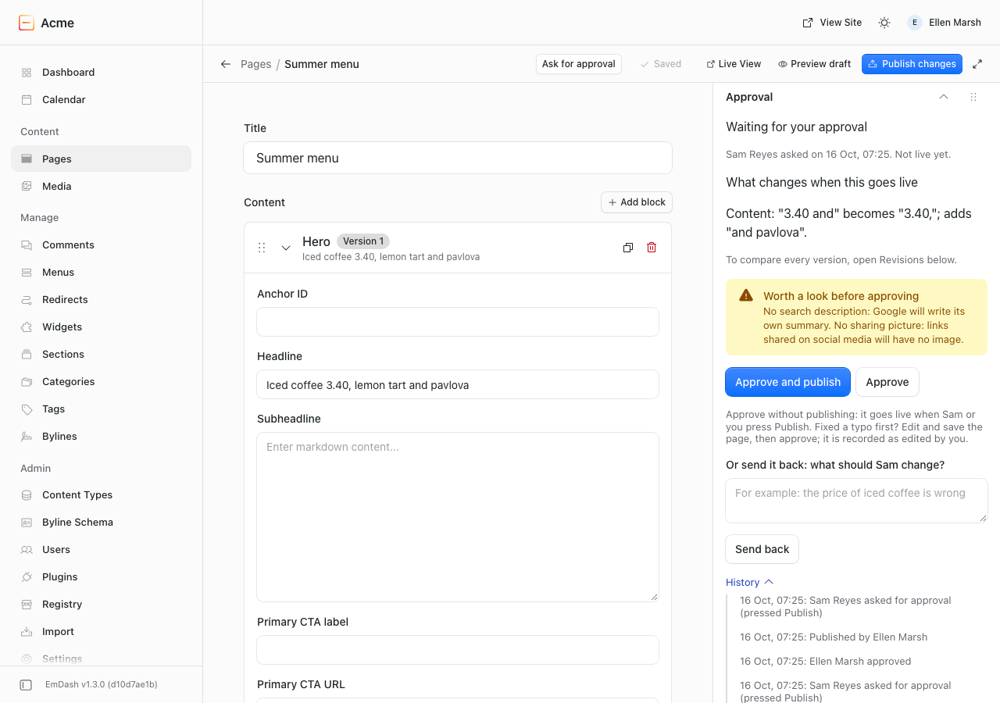

# @moorage/plugin-approvals

Content Approval for [EmDash](https://emdashcms.com): a second person OKs a page before it goes live. Writers keep pressing Publish; when a page needs approval, the publish is held and becomes a request, and the writer reads "Sent for approval. Not live yet." The approver approves and publishes in one step, approves for later, or sends it back with a note, and sees what changed in words. Runs on any EmDash site with no account and no key.



## What it does

- **Holds publishing** on the content types you tick: Publish and Schedule, from the editor, from AI tools, from other plugins and from scheduled runs. A held Publish makes the request by itself.
- **Ask for approval**: a button in the editor's toolbar for anyone who may edit the page. Contributors, who cannot publish and do not see plugin buttons in the editor, find their drafts on the Approvals page with an "Ask for approval" button on each.
- **Decide** in the page's Approval panel or on the Approvals page: **Approve and publish**, **Approve** (publish later), or **Send back** with a note. Admins can also **Approve without review**, with a reason that is recorded and emailed to the other approvers.
- **What changed, in words**: `Content: "£3.20" becomes "£3.40"; adds "pavlova"`, against the live page; after an approval, against the version that was approved. Pictures say "changed". The page's own Revisions panel compares every version.
- **A text copy of each approved version**, on the History tab, so nobody can say they never saw it.
- **Approvers can fix a typo**: they edit and save the page as usual, then approve. The history says "Edited by Ellen Marsh before approving: Content".
- **An approval belongs to one version.** Any saved change afterwards asks again, and says what changed since.
- **Checks**: no search description, no sharing picture (from EmDash's SEO panel), shown as a reminder, required before approval, or off.
- **Email**, when your site can send it: to approvers when someone asks (at most once a day per page), to the writer when they decide, one reminder after two days. Subjects start with the site's name. Without email, requests show on the dashboard widget and the Approvals page.

## What it does not do

- **It cannot hold what EmDash saves straight to a live page**: the SEO panel, categories, tags and bylines of a page that is already live, and every save in a content type that keeps no drafts. Taking a page off the site (Unpublish) is not held either. The Settings tab lists these for your site.
- No discussion threads, mentions or inline comments; no chains of approvers, named approvers or approval by several people; no Slack.
- No editing inside the Approval panel: approvers edit the page in the editor.

## Install

From **Plugins** in your EmDash admin, or in code:

```sh
pnpm add @moorage/plugin-approvals
```

```js
// astro.config.mjs
import approvals from "@moorage/plugin-approvals";
import emdash from "emdash/astro";

export default defineConfig({
	integrations: [emdash({ sandboxed: [approvals] })],
});
```

On a site without a sandbox runner, list it under `plugins: [approvals]` instead; it behaves the same. Needs EmDash 1.3.0 or later.

Then open **Approvals** in the sidebar. **Nothing is held until an admin saves the Settings tab once**, AI tools included.

## Settings

One Settings tab, for admins:

| Setting                                                                                                                                                                                                                 | Default            |
| ----------------------------------------------------------------------------------------------------------------------------------------------------------------------------------------------------------------------- | ------------------ |
| Which content needs approval                                                                                                                                                                                            | none               |
| Who needs approval: **Others need my OK before publishing** (everyone below admin is held; admins approve) or **I need someone else's OK before publishing** (everyone is held, admins too; editors and admins approve) | Others need my OK  |
| AI tools connected to your site always need a person's OK (on every content type, even those not ticked)                                                                                                                | on                 |
| Check for a search description and a sharing picture: show as a reminder, require before approval, don't check                                                                                                          | show as a reminder |
| Remind approvers once after 2 days (only when the site can send email)                                                                                                                                                  | on                 |

Nobody approves their own request. Work from an AI tool is the exception: the person whose key the tool uses may approve it.

## Safety

- **It fails safe.** Once a publish is known to need approval, any error inside the plugin refuses it with a plain message ("Not published: approval could not be checked just now. Nothing has changed.") instead of letting it through. If the plugin cannot even read its settings, every publish is refused the same way. A plugin that takes longer than 5 seconds is stopped by EmDash, which then shows its own "Failed to run content:beforePublish policy"; the plugin keeps its work small and sends email later so that does not happen. To get out of a stuck state, disable the plugin under Plugins.
- Content types that are not ticked are let through before the plugin does anything else.

## Permissions

Holds publishing (`hooks.content-policy:register`); reads content, drafts and the content schema to show what changed (`content:read`, `content:revisions:read`, `schema:read`); publishes when an approver presses Approve and publish (`content:publish`); reads users' names and emails to address approvers (`users:read`); sends email (`email:send`). Contributors and up can open the Approvals page; each person sees only their part.

## FAQ

**Why does the editor say "Failed to publish"?** That title is EmDash's own and a plugin cannot change it. The text under it starts "Sent for approval. Not live yet.": nothing failed.

**Can a writer get around it?** Not through Publish or Schedule on a ticked content type, from anywhere. What EmDash saves straight to a live page (see above) is not held.

**What if I am the only person on the site?** Settings says approval needs a second person; until there is one, an admin can use Approve without review.

**Is it free?** Yes, on any number of sites, with no account and no key. MIT License.

## Develop

`pnpm build`, `pnpm test` (unit tests in the real sandbox with `@emdash-cms/plugin-test`), `pnpm typecheck`, `pnpm validate`. Browser tests: `DEMO_SITE_PORT=4404 pnpm --filter demo-site exec playwright test tests/approvals.spec.ts`, and with `DEMO_SITE_APPROVALS=in-process` for the in-process install. `APPROVALS_SCREENSHOTS=1` refreshes the pictures in `images/`.

## Changelog

See [CHANGELOG.md](CHANGELOG.md). 0.1.0 is the first version.
