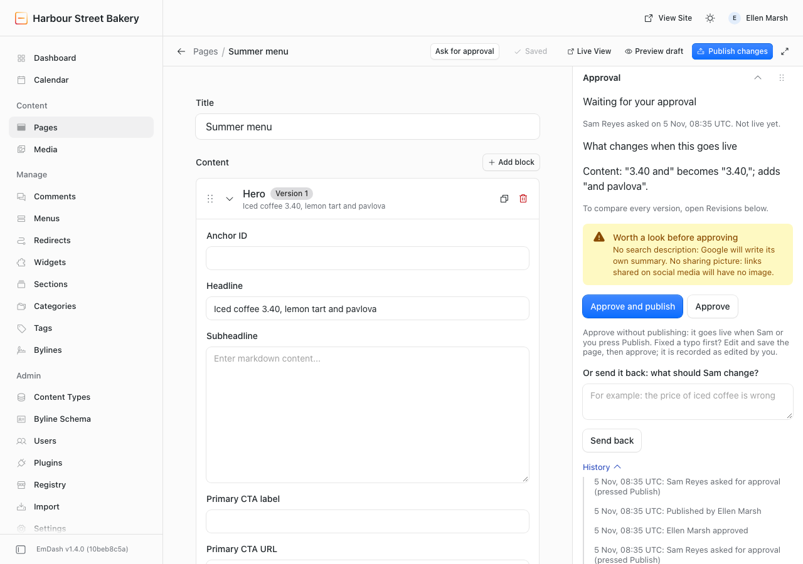
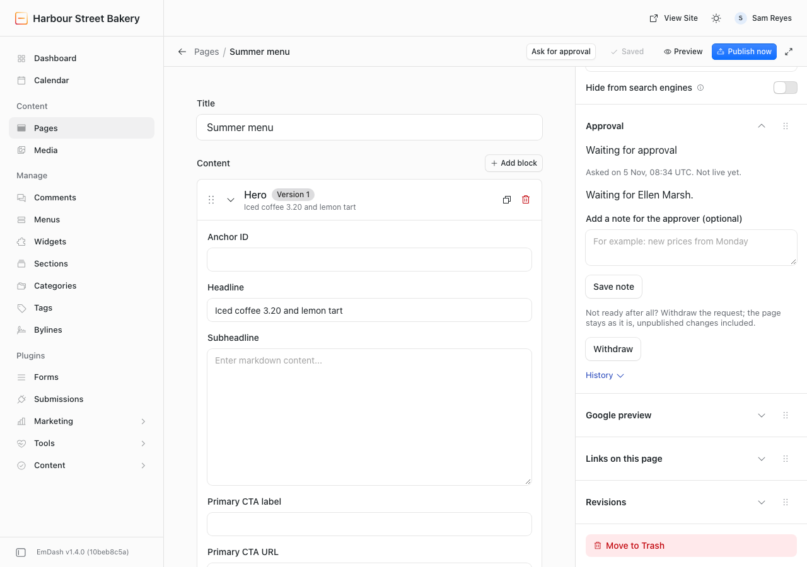
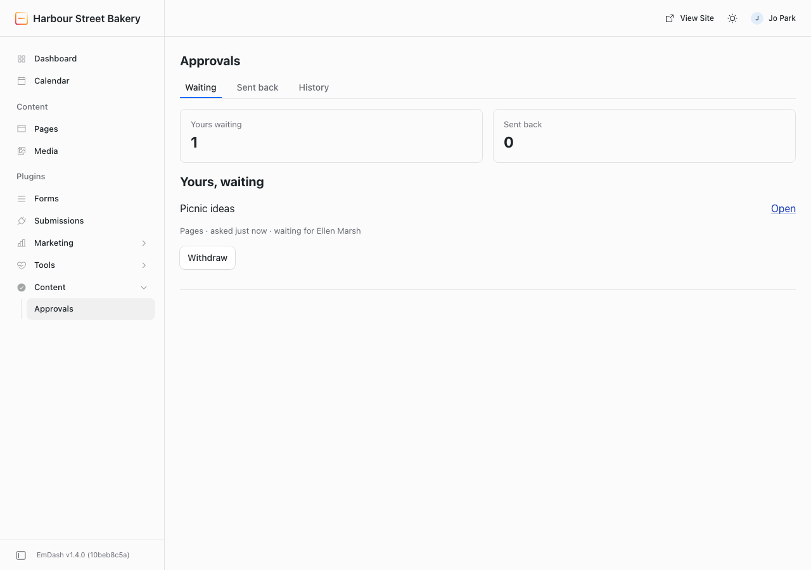

# @moorage/plugin-approvals

Content Approval for [EmDash](https://emdashcms.com): a second person OKs a page before it goes live. Writers keep pressing Publish; when a page needs approval, the publish is held and becomes a request, and the writer reads "Sent for approval. Not live yet." The approver approves and publishes in one step, approves for later, or sends it back with a note, and sees what changed in words. Runs on any EmDash site with no account and no key.



## What it does

- **Holds publishing** on the content types you tick: Publish and Schedule, from the editor, from AI tools, from other plugins and from scheduled runs. A held Publish makes the request by itself.
- **Ask for approval**: a button in the editor's toolbar for Authors (on their own pages), Editors and Admins. Contributors ask from **Approvals > Your drafts**, which has an "Ask for approval" button on each of their drafts (from the first three content types that need approval). EmDash 1.3.1 to 1.5.0 still show Contributors the editor's button and the Approval panel but refuse them before the plugin runs, so the button says "Plugin action failed" and the panel "Plugin panel unavailable." (see the FAQ).
- **Decide** in the page's Approval panel or on the Approvals page: **Approve and publish**, **Approve** (publish later), or **Send back** with a note. Admins can also **Approve without review**, with a reason that is recorded and emailed to the other approvers. On the Approvals page a decision ends on a short confirmation with **Back to the list**. Nobody approves their own request: the Approvals page lists yours apart, under **Yours, waiting**, with what it waits for, and an admin can open their own and **Publish without review**, with a reason.
- **Withdraw**: the person who asked can take a waiting request back, from the page's Approval panel or from **Yours, waiting** on the Approvals page (Contributors use the Approvals page). Nothing is published and the page stays as it is; approvers no longer see it, and the email about it is not sent if it has not gone yet. Asking again the same day does not email the approvers a second time.
  - **What changed, in words**: `Content: "£3.20" becomes "£3.40"; adds "pavlova"`, against the live page; after an approval, against the version that was approved. Pictures say "changed". The page's own Revisions panel compares every version.
- **A text copy of what was approved**: the History tab shows, for each page decided recently, the text of its latest approval, so nobody can say they never saw it. Earlier approved texts are not shown; the page's own Revisions panel keeps every version. Dates read "19 Oct 2026", or "19 Oct 2026, 14:05 UTC" with a time.
- **Times are in UTC, and say so**, on every screen and in emails ("16 Oct, 10:42 UTC"): EmDash does not tell plugins the site's time zone.
- **Approvers can fix a typo**: they edit and save the page as usual, then approve. The history says "Edited by Ellen Marsh before approving: Content".
- **An approval belongs to one version.** Any saved change afterwards asks again, and says what changed since.
- **Checks**: no search description, no sharing picture (from EmDash's SEO panel), shown as a reminder, required before approval, or off.
- **Email**, when your site can send it: to approvers when someone asks (at most once a day per page), to the writer when they decide, one reminder after two days. Subjects start with the site's name. Emails go out from a background task, usually within a minute; on a site with many approvers a few go out each run until everyone has theirs, and an email that fails is tried twice more, five minutes apart. Without email, requests show on the dashboard widget and the Approvals page.

| Withdraw, in the Approval panel      | Withdraw, under Yours, waiting      |
| ------------------------------------ | ----------------------------------- |
|  |  |

## What it does not do

- **It cannot hold what EmDash saves straight to a live page**: the SEO panel, categories, tags and bylines of a page that is already live, and every save in a content type that keeps no drafts. The Settings tab lists these for your site.
- **Taking a page off the site (Unpublish) is not held, by choice.** EmDash would let a plugin hold it too, but a page that is wrong should always be able to come down at once, without waiting for anyone.
- No discussion threads, mentions or inline comments; no chains of approvers, named approvers or approval by several people; no Slack.
- No editing inside the Approval panel: approvers edit the page in the editor.

## Install

From **Registry** in your EmDash admin, or in code:

```sh
pnpm add @moorage/plugin-approvals
```

```js
// astro.config.mjs
import approvals from "@moorage/plugin-approvals";
import emdash from "emdash/astro";

export default defineConfig({
	integrations: [emdash({ sandboxed: [approvals] })],
});
```

`sandboxed` needs a sandbox runner. On Cloudflare that is two things: the `LOADER` Worker Loader binding in `wrangler.jsonc` (Workers Paid only) and `sandboxRunner: sandbox()` in `astro.config.mjs`, with `sandbox` imported from `@emdash-cms/cloudflare`; answering Yes to sandboxed plugins in `create-emdash` adds only the binding. On a site without one, list it under `plugins: [approvals]` instead; it behaves the same. Needs EmDash 1.5.0 or later (0.3 and earlier: 1.3.0). Since 0.1.6 your settings survive moving the plugin from one list to the other; when updating from an earlier version, update first, open the Approvals page once, then move it.

**Sandboxed on Cloudflare, use 0.2.0 or later.** There a sandboxed plugin may make at most 10 calls to the site for each click, page or background run. Up to 0.1.6 the Approvals page with two or more pages waiting, most Approve and Publish buttons, and emails to many approvers needed more, and failed part-way; with those versions, list the plugin under `plugins: [approvals]`. From 0.2.0 every page, button and background run makes at most 9 calls, however many pages wait and however many people approve.

**On Cloudflare's Workers free plan** each request gets about 10 ms of CPU. EmDash's own saving and publishing already comes close to that, and every plugin run in the site's process adds a little, so a save or publish can now and then fail with "Worker exceeded resource limits"; trying again works. Workers Paid (30 seconds per request) does not have this problem.

Then open **Approvals** in the sidebar. **Nothing is held until an admin saves the Settings tab once**, AI tools included. Pages already scheduled when approval is switched on need approval too before they go live; the Settings tab names them, with their time (from the first three content types; it says when there are more to check).

## Settings

One Settings tab, for admins:

| Setting                                                                                                                                                                                                                 | Default            |
| ----------------------------------------------------------------------------------------------------------------------------------------------------------------------------------------------------------------------- | ------------------ |
| Which content needs approval                                                                                                                                                                                            | none               |
| Who needs approval: **Others need my OK before publishing** (everyone below admin is held; admins approve) or **I need someone else's OK before publishing** (everyone is held, admins too; editors and admins approve) | Others need my OK  |
| AI tools connected to your site always need a person's OK (on every content type, even those not ticked)                                                                                                                | on                 |
| Check for a search description and a sharing picture: show as a reminder, require before approval, don't check                                                                                                          | show as a reminder |
| Remind approvers once after 2 days (only when the site can send email)                                                                                                                                                  | on                 |

Nobody approves their own request. Work from an AI tool is the exception: the person whose key the tool uses may approve it.

## Safety

- **It fails safe.** Once a publish is known to need approval, any error inside the plugin refuses it with a plain message ("Not published: approval could not be checked just now. Nothing has changed.") instead of letting it through. If the plugin cannot even read its settings, every publish is refused the same way. A plugin that takes longer than 5 seconds is stopped by EmDash, which then shows its own "Failed to run content:beforePublish policy"; the plugin keeps its work small and sends email later so that does not happen. To get out of a stuck state, disable the plugin under Plugins.
- Content types that are not ticked are let through before the plugin does anything else.

## Use with an AI assistant (MCP)

An AI assistant connected to your site through EmDash's MCP server (`/_emdash/api/mcp`) can read approvals with two tools. Both are read-only: they never publish, approve or change anything, and never return email addresses.

| Tool                | What it returns                                                                                                                                                                                                                                               |
| ------------------- | ------------------------------------------------------------------------------------------------------------------------------------------------------------------------------------------------------------------------------------------------------------- |
| `approvals__queue`  | The pages waiting for approval, as the Approvals page lists them for you: those waiting for you to approve and your own that wait, each with title, content type, id, who asked, when, publish or schedule, and counts.                                       |
| `approvals__status` | One entry's approval (give `collection` and `id`), as its Approval panel shows it: whether publishing it needs approval (for you, and for an AI tool on your key), waiting, approved, sent back or published, by whom and when, and the latest history lines. |

Each person gets only their part, as on the Approvals page: approvers see every waiting page; Authors and Contributors only their own; Subscribers nothing.

The tools are off until an Admin switches them on for Content Approval in EmDash's plugin settings (after a Registry update that adds tools, EmDash asks again). The assistant's token needs the scope `mcp:tools:approvals` (or `mcp:tools` for every plugin's tools). Needs EmDash 1.5.0 or later.

An AI tool that changes the SEO panel of a page that is already live saves it straight to the live page, and EmDash does not yet tell plugins that such a save came from an AI tool, so it is not held or noted (see "What it does not do").

To let an AI tool change a live page's text safely, have it save the change as a draft and then publish: the publish is held for approval like anyone else's, and the AI tool is told a person will approve it. This does not cover the SEO panel, which EmDash saves live at once (above). Approving always stays with a person; no tool approves.

## Permissions

Holds publishing (`hooks.content-policy:register`); reads content, drafts and the content schema to show what changed (`content:read`, `content:revisions:read`, `schema:read`); publishes when an approver presses Approve and publish (`content:publish`); reads users' names and emails to address approvers (`users:read`); sends email (`email:send`). Contributors and up can open the Approvals page; each person sees only their part.

## FAQ

**Why does the editor say "Failed to publish"?** That title is EmDash's own and a plugin cannot change it. The text under it starts "Sent for approval. Not live yet.": nothing failed.

**Why does a Contributor see "Plugin action failed" in the editor?** EmDash still does this in 1.5.0 (checked 2026-11-12), as in 1.3.1 and 1.4.0: it shows plugin buttons and panels in the editor to Contributors, then refuses what they press, because it lets only Authors and up use them. A plugin cannot hide them or change that. Contributors ask from **Approvals > Your drafts** instead, and see their requests there.

**Can a writer get around it?** Not through Publish or Schedule on a ticked content type, from anywhere. What EmDash saves straight to a live page (see above) is not held.

**What if I am the only person on the site?** Under "I need someone else's OK" your own pages wait for an editor or another admin. When nobody else can approve, Settings, the Approvals page and the held Publish all say approval needs a second person; until there is one, open your request in Approvals and use **Publish without review**.

**The links in approval emails point to an old address.** Plugins keep the site address EmDash had when the server started. After changing the site's address, restart the site.

**What is the line at the foot of the page?** Only admins see it: "Help · More free plugins · by Moorage", links to the guide on moorage.dev and to more free plugins. Editors never see it. To hide it, switch on "Hide the help line at the foot of this page" at the bottom of the Settings tab, with the other settings, and press Save.

**Is it free?** Yes, on any number of sites, with no account and no key. MIT License.

## Develop

`pnpm build`, `pnpm test` (unit tests in the real sandbox with `@emdash-cms/plugin-test`), `pnpm typecheck`, `pnpm validate`. Browser tests: `DEMO_SITE_PORT=4404 pnpm --filter demo-site exec playwright test tests/approvals.spec.ts`, and with `DEMO_SITE_APPROVALS=in-process` for the in-process install. `APPROVALS_SCREENSHOTS=1` writes the pictures into `images/`, under names that carry the version (the site reuses a picture by its file name).

## Changelog

See [CHANGELOG.md](CHANGELOG.md). 0.1.0 is the first version.
