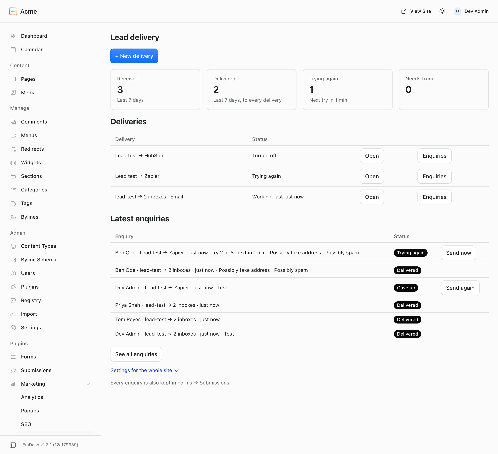
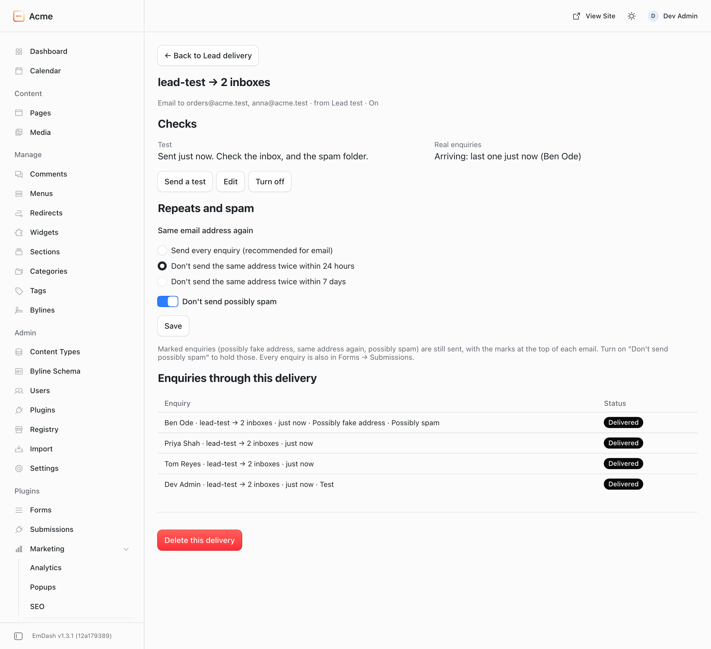

# @moorage/plugin-lead-delivery

Lead Delivery for [EmDash](https://emdashcms.com) sends every enquiry from your forms where you work: your inbox, HubSpot, or another app such as Zapier, Make or n8n. Each enquiry is logged and tried again if it does not get through. If one cannot be delivered, everyone who looks after the site hears about it. It works with the official forms plugin, on any EmDash site, with no account and no key.



## How it works

A **delivery** is one form and where its enquiries go: an inbox (or several), a HubSpot form, or another app. Lead Delivery names it for you, for example "Contact form → Shop inbox", and you can rename it. One form can have several deliveries, for example "Contact form → Shop inbox" and "Contact form → HubSpot".

Everything is on one page, **Lead delivery** under Marketing:

- **Home**: this week's counters (received, delivered, trying again, needs fixing), a red notice for each delivery that needs fixing, the list of deliveries with **Open** on each row (Editors get **Enquiries**), the latest enquiries, and the **Settings for the whole site** (folded away).
- **New delivery**: choose the form and where to send, then the details. A test is sent when you save (for HubSpot only when you ask, because a test adds a contact). If the form has never been connected, Connect this form comes next: in one step with EmDash's approval where the site can call itself, otherwise with written instructions.
- **A delivery's page**: its two checks (did the test arrive; are real enquiries arriving), Send a test, Edit, Turn off, the repeat and spam choices, its own enquiries, and Delete.
- **Edit**: the name, the address or HubSpot form, which forms it takes (one form usually; several, or all forms including new ones, for an inbox that gets everything), on or off, and HubSpot field matching.
- **Enquiries**: the whole log, or one delivery's, with Send again.



## What it does

- **Email.** Sends each enquiry to one or more addresses, using the form's own field labels. Pressing Reply answers the person who sent it.
- **HubSpot.** Each enquiry becomes a HubSpot form submission, so your HubSpot workflows and notifications run.
  - Paste the HubSpot form's share link or embed code. No HubSpot key is stored.
  - Each form field is matched to a HubSpot field from a list. This happens automatically where the names make it obvious. A form's fields are known once it has sent an enquiry, or when the site can look the form up.
  - Consent goes to HubSpot only when someone ticked a consent box, or when you say your HubSpot account has its privacy (GDPR) settings on.
  - Possibly fake email addresses can be marked in a HubSpot field you choose.
- **Another app (Zapier, Make, n8n or your own).** Each enquiry is sent as flat JSON, signed with the [Standard Webhooks](https://www.standardwebhooks.com/) headers, with one secret for each delivery. The JSON has a `marks` list (`throwaway`, `repeat`, `spam`) and, for a repeat, `repeatAfterMinutes`.
- **A delivery log** that Editors (usually your client) can read. It shows who sent the enquiry, through which delivery, and whether it arrived, with a Send again button.
- **Retries.** An enquiry that gets no answer is tried 8 times over about two days. When a service refuses an enquiry for a reason that would fail the same way again, it is not retried. Instead, the page says in plain words what to fix, with the service's own words beneath. A test is never retried.
- **Alerts by email** to several addresses. The subject starts with the site's name, and each kind of alert is sent at most once a day. There are three kinds:
  - an enquiry could not be delivered;
  - a form that usually gets enquiries has had none for 3 days;
  - retries are not running, because scheduled tasks are not running on the site.
- **Marks, not filters.** Three things are marked in the log and at the top of each delivered email, and the enquiry is still sent:
  - a possibly fake address (from about 150 services that hand out short-lived inboxes);
  - the same address again ("same address 3 hours earlier");
  - possibly spam: three or more links, a known sales-pitch phrase (such as "SEO services" or "guest post"), a message that is only a link, or a link in the name.
- **Repeats and spam, for each delivery.** "Same email address again": send every enquiry (the default, recommended for email), or don't send the same address twice within 24 hours, or within 7 days. "Don't send possibly spam" holds those enquiries. Either way, a held enquiry is listed as **Not sent** with the reason, and Send again sends it.
- **The page and UTM values** are sent with each enquiry when the form provides them: form fields named `page_url`, `utm_source`, `utm_medium`, `utm_campaign`, `utm_term` or `utm_content`.
- **A dashboard widget**, "Enquiries this week".

## What it does not do

- No Mailchimp yet.
- File attachments are not sent. The log says the enquiry has one, and the file stays in Forms → Submissions.
- It does not replace the Forms inbox: every enquiry is kept there whatever happens here.
- It does not block spam at the form. See "Stop spam" below.
- No reports or charts, no routing rules, no syncing back from HubSpot, no HubSpot tracking cookie.

## Install

```sh
pnpm add @moorage/plugin-lead-delivery
```

```js
// astro.config.mjs
import { formsPlugin } from "@emdash-cms/plugin-forms";
import leadDelivery from "@moorage/plugin-lead-delivery";

emdash({
	plugins: [formsPlugin()],
	sandboxed: [leadDelivery], // or plugins: [formsPlugin(), leadDelivery] on a site without a sandbox
});
```

It needs EmDash 1.3 or later and the official forms plugin. Use the forms plugin 0.2.11 or later: earlier versions save a ticked single checkbox, such as a consent box, as unticked, so the enquiry arrives without consent. Retries and alerts need scheduled tasks: on Cloudflare, a Cron Trigger every minute (the EmDash templates have one).

**On Cloudflare's Workers free plan** each request gets about 10 ms of CPU. EmDash's own saving and publishing already comes close to that, and every plugin run in the site's process adds a little, so a save or publish can now and then fail with "Worker exceeded resource limits"; trying again works. Workers Paid (30 seconds per request) does not have this problem.

## Connecting a form

EmDash's form editor cannot yet be pointed at another plugin. When you make a form's first delivery, **Connect this form** comes next. It works one of two ways.

**In one step, with EmDash's approval** (only when the site can call its own address, see below, and only for admins):

1. Connect this form shows a code, for example `ABCD-EFGH`, and **Open the approval page**. The page is EmDash's own, opens in a new tab, and opens empty.
2. Type the code in its Device code box. EmDash's page says "Authorize Device" and asks for full admin access: that is Lead Delivery asking. Press **Authorize** only if you opened that page from Lead delivery just now. If someone sent you a link or a code, press **Deny**.
3. Come back and press **Done, connect**. Lead Delivery uses that access once: it lists your forms (so "Which form?" knows them from then on), sets the form's `webhookUrl` to its private address, and throws the access away. It keeps nothing. The code works for 15 minutes; leaving the screen throws it away.

If the form already sends to another address (Zapier, for example), nothing is changed: Lead Delivery names that address's host and asks first. **Replace it** takes one more approval; **Keep it** shows the instructions for the email way, which keeps that address. If EmDash answers in any way Lead Delivery does not expect (a later EmDash may change its approval page), the screen falls back to the written instructions with a short note. In the rare case that throwing the access away fails twice, the page and an email to the alert list say so: nobody holds it (it was only in memory for that one step), EmDash ends it by itself within 90 days, and another admin can end it now by disabling your account under Users and enabling it again.

**By hand, with written instructions** (every other site, and always available under "Instructions for your web person"): someone who looks after the site's code connects each form once. The screen shows the instructions for that form and can email them to your web person. Press **I have done this** once they have, or **Skip for now**: the delivery's page says "Not sending yet: … is not connected" with a **Connect this form** button until the form is connected.

In **New delivery**, "Which form?" lists the forms Lead Delivery already knows (from enquiries, and from forms named before). For another form, choose **Another form** and type its short name: Forms lists it under each form's name.

When enquiries arrive from a form no delivery takes (for example because the form's email names it differently from the short name you typed), they are kept and listed as Not sent, and the page says so: "2 enquiries from Contact us were not sent: no delivery takes this form". One press adds that form to your delivery (or lets you choose which, starting with the one that has received nothing) and sends them. A delivery that has received nothing also asks "Enquiries arrived from Contact us instead: is that the one?".

Lead Delivery checks once which of two ways works on your site:

- **Straight from the form.** The form's `webhookUrl` is set to the plugin's private address. This needs the site to be able to call its own address. On Cloudflare that needs the compatibility flag `global_fetch_strictly_public`.
- **Through the form's email.** The form's notification list gets one private address ending in `@lead-delivery.invalid`. When the forms plugin sends that email, Lead Delivery takes the enquiry from it and cancels the email, so nobody receives it and nothing leaves the site. This needs email to be set up on the site and the form's daily digest to be off. It has some limits:
  - the email carries field labels rather than field names;
  - hidden fields, such as UTM values, are left out of it;
  - a message that itself contains lines like "Label: value" can be split wrongly.

"Reset the private address" (under Settings for the whole site) changes both addresses. Every connected form stops sending until it is connected again, and each delivery's page offers Connect this form again.

## Stop spam

Lead Delivery marks possibly spam; it does not stop it reaching the form. To stop bots at the form, turn on Turnstile in the form's settings under Forms. Forms with Turnstile cannot go in a popup yet.

## Settings

All on the one page:

- **Each delivery** (admins): its name, the address, HubSpot form or app, which forms it takes, on or off, "Same email address again" (off, 24 hours or 7 days), "Don't send possibly spam", HubSpot field matching, and for an app a new signing secret.
- **Settings for the whole site** (admins), folded at the bottom of the page. It opens by itself when nobody gets alerts or the forms have no way to hand enquiries over:
  - who hears when something needs fixing (prefilled with your own address);
  - this site's check, with Check again;
  - the private address, with Reset.

These are fixed, not settings: the retry schedule, keeping log rows for 30 days, and deleting an enquiry's contents once all its deliveries are done.

## Updating from 0.1

Nothing to do. On the first run after the update, each inbox, HubSpot form or app you set up becomes a delivery with the same id, so the log, retries, HubSpot matching and app secrets stay as they were, and connected forms keep sending to the same private address. Each delivery gets a new name from its forms and where it sends (for example "All forms → Shop inbox"); the page says so once. "Don't send the same person twice within 24 hours" becomes "Don't send the same address twice within 24 hours".

## FAQ

**Does it lose enquiries?** Not from the moment one reaches it. Each enquiry is stored once and kept until all its deliveries are done, and every enquiry is also in Forms → Submissions. An enquiry from a form with no delivery is listed as Not sent. If a form stops reaching the plugin altogether, the quiet-form alert tells you after 3 days.

**Why was a marked enquiry still sent?** Marks are a guess, so they never block on their own. Turn on "Don't send possibly spam" or a repeat choice on the delivery's page to hold those.

**Why does HubSpot say a field is not on the form?** HubSpot accepts only the fields on that HubSpot form. Add the field there, or choose another one in the delivery's Edit. Then press Send again.

**Why does HubSpot refuse every enquiry?** CAPTCHA may be on for that HubSpot form. HubSpot refuses enquiries sent from a website to a form that has CAPTCHA on.

**Does Zapier cost money?** "Webhooks by Zapier" needs a paid Zapier plan. Make's Custom webhook and n8n's Webhook node do not.

**How does my app check an enquiry came from my site?** Check the `webhook-signature` header with the secret shown when you saved the delivery. Any Standard Webhooks library does it.

**Why does one-step connecting ask for full admin access?** EmDash has no narrower access for this yet. Lead Delivery uses it for two calls (list the forms, set one form's address) and throws it away straight after; it never stores it. You type the code yourself on EmDash's page, so a link someone sends you cannot approve anything on its own.

**Why is there no one-step connecting on my site?** It needs the site to call its own address (on Cloudflare: the compatibility flag `global_fetch_strictly_public`). Press Check again under Settings for the whole site after changing that. Editors never see it: only an admin can approve.

**Can my clients change it?** No. Editors see the counters, the deliveries and the log, and can press Send again; only admins add or change deliveries.

**Is it free?** Yes, on any number of sites, your own or your clients', with no account and no key. It is open source under the MIT License.

## Changelog

0.3.0: connect a form in one step with EmDash's approval, where the site can call itself. 0.2.0: deliveries, one page, repeats for 24 hours or 7 days, the possibly spam mark, marks at the top of each email. 0.1.0: the first version. Every change is listed in CHANGELOG.md.

## Develop

```sh
pnpm --filter @moorage/plugin-lead-delivery test     # validate, then unit tests through the sandbox
pnpm --filter @moorage/plugin-lead-delivery build
DEMO_SITE_PORT=4401 pnpm --filter demo-site exec playwright test tests/lead-delivery.spec.ts
DEMO_SITE_PORT=4401 DEMO_SITE_LEAD_DELIVERY=in-process pnpm --filter demo-site exec playwright test tests/lead-delivery.spec.ts
# One-step connect needs a site that can call itself; localhost cannot, so this test-only switch
# serves the demo site under a made-up name that it can call (apps/demo-site/self-alias.mjs):
DEMO_SITE_PORT=4401 DEMO_SITE_SELF_ALIAS=1 pnpm --filter demo-site exec playwright test tests/lead-delivery-connect.spec.ts
DEMO_SITE_PORT=4401 DEMO_SITE_SCREENSHOTS=1 pnpm --filter demo-site exec playwright test tests/lead-delivery.spec.ts   # refresh images/
```

The tests never call a real service. HubSpot and the apps are simulated in the unit tests, and the browser tests use the dev email inbox and `.invalid` addresses.
