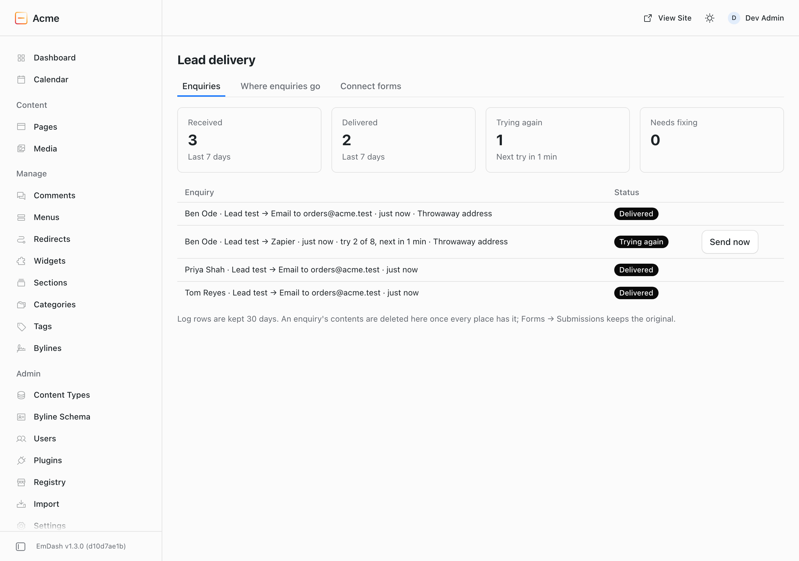

# @moorage/plugin-lead-delivery

Lead Delivery for [EmDash](https://emdashcms.com) sends every enquiry from your forms where you work: your inbox, HubSpot, or another app such as Zapier, Make or n8n. Each enquiry is logged and tried again if it does not get through. If one cannot be delivered, everyone who looks after the site hears about it. It works with the official forms plugin, on any EmDash site, with no account and no key.



## What it does

- **Email.** Sends each enquiry to one or more addresses, using the form's own field labels. Pressing Reply answers the person who sent it.
- **HubSpot.** Each enquiry becomes a HubSpot form submission, so your HubSpot workflows and notifications run.
  - Paste the HubSpot form's share link or embed code. No HubSpot key is stored.
  - Each form field is matched to a HubSpot field from a list. This happens automatically where the names make it obvious, and works before the first enquiry when the site can look the form up.
  - Consent goes to HubSpot only when someone ticked a consent box, or when you say your HubSpot account has its privacy (GDPR) settings on.
  - Possibly fake email addresses (from services that hand out short-lived inboxes) can be marked in a HubSpot field you choose.
- **Another app (Zapier, Make, n8n or your own).** Each enquiry is sent as flat JSON, signed with the [Standard Webhooks](https://www.standardwebhooks.com/) headers, with one secret for each app.
- **A delivery log** that Editors (usually your client) can read. It shows who sent the enquiry, from which form, where it went and whether it arrived, with a Send again button.
- **Retries.** An enquiry that gets no answer is tried 8 times over about two days. When a service refuses an enquiry for a reason that would fail the same way again, it is not retried. Instead, the admin says in plain words what to fix, with the service's own words beneath.
- **Alerts by email** to several addresses. The subject starts with the site's name, and each kind of alert is sent at most once a day. There are three kinds:
  - an enquiry could not be delivered;
  - a form that usually gets enquiries has had none for 3 days;
  - retries are waiting because scheduled tasks are not running.
- **Flags, not filters.** Possibly fake email addresses (from about 150 services that hand out short-lived inboxes) and the same person sending again are marked in the log, and are still delivered. If you want, turn on "Don't send the same person twice within 24 hours" for a place.
- **The page and UTM values** are sent with each enquiry when the form provides them: form fields named `page_url`, `utm_source`, `utm_medium`, `utm_campaign`, `utm_term` or `utm_content`.
- **Send a test** to each place. For HubSpot it asks first, because a test adds a contact.
- **A dashboard widget**, "Enquiries this week".

## What it does not do

- No Mailchimp yet. It is the next release.
- File attachments are not sent. The log says the enquiry has one, and the file stays in Forms → Submissions.
- It does not replace the Forms inbox: every enquiry is kept there whatever happens here.
- No reports or charts, no routing rules, no syncing back from HubSpot, no HubSpot tracking cookie.

## Install

```sh
pnpm add @moorage/plugin-lead-delivery
```

```js
// astro.config.mjs
import { formsPlugin } from "@emdash-cms/plugin-forms";
import leadDelivery from "@moorage/plugin-lead-delivery";

emdash({
	plugins: [formsPlugin()],
	sandboxed: [leadDelivery], // or plugins: [formsPlugin(), leadDelivery] on a site without a sandbox
});
```

It needs EmDash 1.3 or later and the official forms plugin. Retries and alerts need scheduled tasks: on Cloudflare, a Cron Trigger every minute (the EmDash templates have one).

**On Cloudflare's Workers free plan** each request gets about 10 ms of CPU. EmDash's own saving and publishing already comes close to that, and every plugin run in the site's process adds a little, so a save or publish can now and then fail with "Worker exceeded resource limits"; trying again works. Workers Paid (30 seconds per request) does not have this problem.

## Connecting a form

EmDash's form editor cannot yet be pointed at another plugin. Until it can, someone who looks after the site's code connects each form once. Open **Lead delivery → Connect forms**, add your forms by their short name (the Slug column under Forms), and press **Check this site**. The plugin then writes the instructions for your web person and can email them. There are two ways to connect, and the check says which one works on your site:

- **Straight from the form.** The form's `webhookUrl` is set to the plugin's private address. This needs the site to be able to call its own address. On Cloudflare that needs the compatibility flag `global_fetch_strictly_public`.
- **Through the form's email.** The form's notification list gets one private address ending in `@lead-delivery.invalid`. When the forms plugin sends that email, Lead Delivery takes the enquiry from it and cancels the email, so nobody receives it and nothing leaves the site. This needs email to be set up on the site and the form's daily digest to be off. It has some limits:
  - the email carries field labels rather than field names;
  - hidden fields, such as UTM values, are left out of it;
  - a message that itself contains lines like "Label: value" can be split wrongly.

"Reset the private address" changes both addresses. Every connected form stops sending until it is connected again.

## Settings

All settings are on one page, **Lead delivery** under Marketing:

- **Enquiries:** the log, Send again, and Send all failed again.
- **Where enquiries go** (admins):
  - the places, each with its forms (all forms, including new ones, by default);
  - an on/off switch for each place;
  - "Don't send the same person twice within 24 hours";
  - HubSpot field matching;
  - who hears when something needs fixing (prefilled with your own address).
- **Connect forms** (admins): your forms, the site check, the instructions, and resetting the private address.

These are fixed, not settings: the retry schedule, keeping log rows for 30 days, and deleting an enquiry's contents once every place has it.

## FAQ

**Does it lose enquiries?** Not from the moment one reaches it. Each enquiry is stored once and kept until every place has it, and every enquiry is also in Forms → Submissions. If a form stops reaching the plugin altogether, the quiet-form alert tells you after 3 days.

**Why does HubSpot say a field is not on the form?** HubSpot accepts only the fields on that HubSpot form. Add the field there, or choose another one under the form's matching. Then press Send again.

**Why does HubSpot refuse every enquiry?** CAPTCHA may be on for that HubSpot form. HubSpot refuses enquiries sent from a website to a form that has CAPTCHA on.

**Does Zapier cost money?** "Webhooks by Zapier" needs a paid Zapier plan. Make's Custom webhook and n8n's Webhook node do not.

**How does my app check an enquiry came from my site?** Check the `webhook-signature` header with the secret shown when you saved the app. Any Standard Webhooks library does it.

**Can my clients change it?** No. Editors see the log and can press Send again; only admins change where enquiries go.

**Is it free?** Yes, on any number of sites, your own or your clients', with no account and no key. It is open source under the MIT License.

## Changelog

0.1.0: the first version. Later changes are listed in CHANGELOG.md.

## Develop

```sh
pnpm --filter @moorage/plugin-lead-delivery test     # validate, then unit tests through the sandbox
pnpm --filter @moorage/plugin-lead-delivery build
DEMO_SITE_PORT=4401 pnpm --filter demo-site exec playwright test tests/lead-delivery.spec.ts
DEMO_SITE_PORT=4401 DEMO_SITE_LEAD_DELIVERY=in-process pnpm --filter demo-site exec playwright test tests/lead-delivery.spec.ts
DEMO_SITE_PORT=4401 DEMO_SITE_SCREENSHOTS=1 pnpm --filter demo-site exec playwright test tests/lead-delivery.spec.ts   # refresh images/
```

The tests never call a real service. HubSpot and the apps are simulated in the unit tests, and the browser tests use the dev email inbox and `.invalid` addresses.
