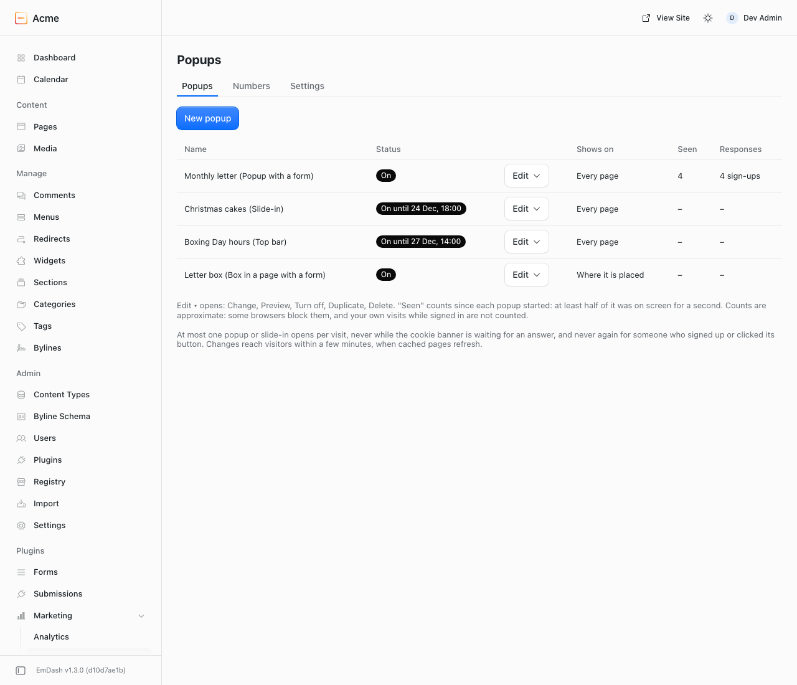
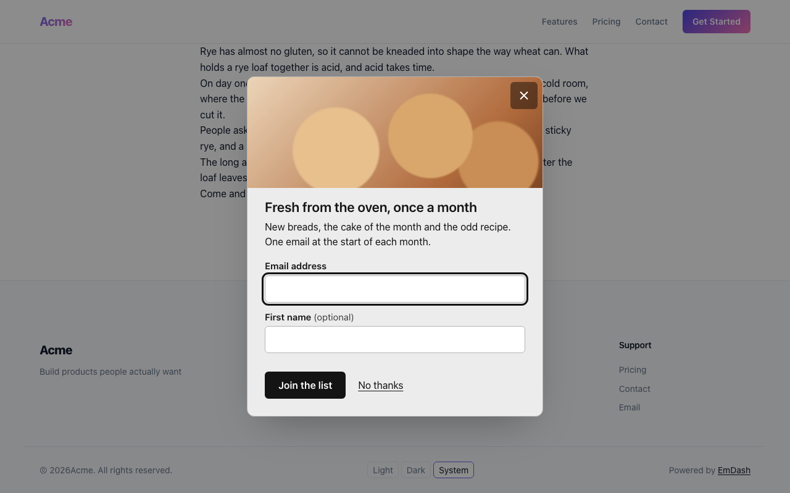
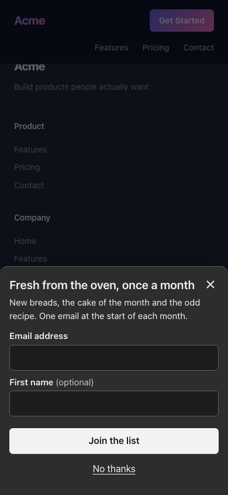
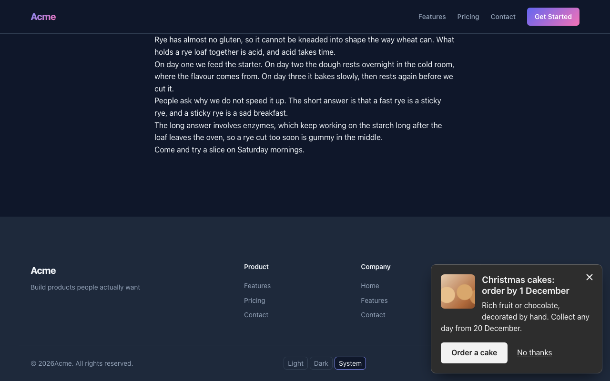
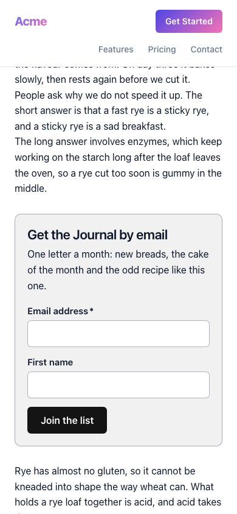

# @moorage/plugin-popups

Popups for [EmDash](https://emdashcms.com): a top bar for news such as opening hours, a slide-in for an offer, a popup with a sign-up form, and a box you place inside a page. Each one is set up in a few steps on one admin page, with safe timings built in, and it respects visitors. It runs on any EmDash site, self-hosted or on Cloudflare, with no account and no key.

**A developer installs it once.** It is a native plugin: someone adds one line to the site's `astro.config.mjs` (below). After that, everything is done on the admin page under Marketing > Popups. It cannot be installed from the plugin registry.



## What it does

- **Four kinds, one look.**
  - **Top bar:** a thin strip above the header, in the page itself. It is part of the page when it loads, so it never moves the page or covers a sticky header.
  - **Slide-in:** a small box in a bottom corner that leaves the page usable. On phones it is a sheet at the bottom, at most 45% of the screen.
  - **Popup:** a box in the middle of the screen that dims the page. On phones it opens as a sheet at the bottom, unless the visitor opened it by clicking.
  - **Box in a page:** a box an editor places in a post or page with the "Popups box" block.
- **What it says:** a heading, a short text, a picture from your media library, and either one button or a form from the official Forms plugin. Sign-ups land in the Forms inbox, with all of its emails and notifications.
- **When it opens:** "after they have read a while" (40% down the page or 30 seconds), "when they click" a link or button your web person sets up, or "when they are about to leave" (computers only). Top bars show as soon as the page opens. There are no raw seconds or percentages to set.
- **Where and when:** every page, pages under an address, or a whole collection; "never on these pages"; phones, computers or both; a start and an end, with a date and a time in your site's time zone.
- **Respect, built in and not switchable:**
  - At most one popup or slide-in per visit.
  - Never while the cookie banner of [Analytics & Cookie Consent](https://www.npmjs.com/package/@moorage/plugin-analytics) (0.2.2 or later) is waiting for an answer.
  - A popup waits for the visitor's second page. On computers you can allow it on the first page.
  - Never while someone is typing.
  - Never again for someone who signed up or clicked. After a close it shows again after a week, after a month, or never.
  - Always a 44 px close button, and Esc closes it. Nothing closes by itself, and the "No thanks" words come from a fixed list.
- **Results:** the views (at least half of it on screen for a second), sign-ups, clicks and closes since each popup started, or for dates you choose, with a spreadsheet download. Rates appear from 100 views. It stores no cookies and nothing about any visitor. Button links to other websites get campaign tags (`utm_source=popups`), so Google Analytics shows those visits as coming from the popup.
- **Preview:** "Preview on your site" (light or dark) shows the popup at once, for you only. It says whether a real visitor would see it now and, if not, why ("this browser closed it 3 days ago; it shows again after a month"). Nothing is counted and the form does not send.
- **Checks:** the form's short name is checked when you save. Colours that are hard to read are refused, and so are unsafe links. If a form later disappears, the popup stays closed (visitors see nothing broken), the list shows a red warning, and the people on the Settings tab get one email that day.

| Popup, computer                            | Popup, phone                            | Slide-in                                     | Box in a page                                    |
| ------------------------------------------ | --------------------------------------- | -------------------------------------------- | ------------------------------------------------ |
|  |  |  |  |

## What it does not do

- No A/B tests, countdowns, "spin to win", full-screen takeovers or exit intent on phones.
- No custom CSS, and no colours, fonts or sizes per popup: one look for all of them.
- It does not build forms. Make the form under Forms, then name it here.
- Forms with Cloudflare Turnstile or a file upload only work in a box in a page for now, not in a popup, slide-in or top bar.
- There is no automatic box "after every post": an editor places the block where it should go.
- No targeting by referrer, country or role, and no language variants.

## Install

```sh
pnpm add @moorage/plugin-popups
```

```js
// astro.config.mjs
import { formsPlugin } from "@emdash-cms/plugin-forms"; // only if you want forms in popups
import { popupsPlugin } from "@moorage/plugin-popups";
import emdash from "emdash/astro";

export default defineConfig({
	integrations: [emdash({ plugins: [formsPlugin(), popupsPlugin()] })],
});
```

It needs EmDash 1.3.0 or later. There are no options; everything is set on the admin page.

### What your theme must render

Your layout must render EmDash's head and body-start components, as every EmDash template already does:

```astro
<head>
	<EmDashHead page={page} />
</head>
<body>
	<EmDashBodyStart page={page} />
	...
	<EmDashBodyEnd page={page} />
</body>
```

The box in a page is a Portable Text block, so it shows wherever your theme renders content with `<PortableText>` from `emdash/ui`.

### Opening a popup with a click

For a popup set to "when they click", link to `#popup-<name>` (a menu item works too) or add `data-popup="<name>"` to any button. The admin shows the exact name in a box to copy.

### Theme colours

Popups take your theme's colours from these CSS variables. All of them are optional, and they can differ in light and dark. When one is missing, the cookie banner's `--cookie-consent-*` variable of the same name is used, then a calm neutral colour.

`--popups-background`, `--popups-text`, `--popups-surface` (the box itself), `--popups-rule` (its edge), `--popups-accent` (buttons), `--popups-accent-text`, `--popups-font`, `--popups-heading-font`, `--popups-radius`, `--popups-shadow`, `--popups-backdrop`.

## Settings

| Where        | Setting                                                    | Default                                          |
| ------------ | ---------------------------------------------------------- | ------------------------------------------------ |
| Each popup   | Kind                                                       | chosen when made                                 |
|              | Heading, text, picture, button or form, "No thanks" words  | No thanks                                        |
|              | When it opens                                              | After they have read a while (top bars: at once) |
|              | Show on the first page they visit (popups, computers only) | Off                                              |
|              | Where, never on these pages, phones or computers           | Every page; phones and computers                 |
|              | Show again after a close                                   | After a month                                    |
|              | Starts, ends (date and time, site's time zone), on or off  | No dates; off until turned on                    |
| Settings tab | Light or dark                                              | Follow the visitor's device                      |
|              | Own colours (checked for contrast)                         | Off: theme colours                               |
|              | Slide-in corner                                            | Bottom right                                     |
|              | Emails when a popup cannot open                            | None                                             |

Editors can change words, pictures, dates and on or off, preview, and read the results. Administrators can also change the kind, the form, where it shows, the settings, and duplicate or delete popups. A site can have up to 20 popups.

## FAQ

**Will it hurt my Google ranking?** Popups on phones open as a sheet at the bottom, never as a box over the page on arrival, and a popup never covers the first page of a visit on phones. That follows Google's guidance on intrusive interstitials.

**Do I need a cookie banner for it?** It sets no cookies. It remembers in the visitor's own browser storage that they closed or signed up, so it does not ask again, and it never sends that anywhere.

**A change I made does not show.** Cached pages refresh within a few minutes. The dates travel with the page, so a popup that has ended stops showing even on a cached page.

**My popup with a form never opens.** Open the admin page: a red warning names the problem (the form was deleted, or it uses Turnstile or a file upload). Use the Preview link to see why a real visitor would not see it.

**Are my own visits counted?** No. A browser that has signed in to the admin is never counted.

## Develop

The browser script is TypeScript under `src/client`. It is built into the server bundle as one string by `client-script.ts` (the same set-up as plugin-analytics), because plugin routes cannot serve JavaScript files. The box in a page is an Astro component under `astro/`, shipped as source like the Forms plugin's, because Astro compiles it.

```sh
pnpm --filter @moorage/plugin-popups test      # Vitest, with happy-dom for the browser script
pnpm --filter demo-site test:e2e               # real browser on the demo site
```

## Changelog

See [CHANGELOG.md](CHANGELOG.md).

## Licence

MIT. Copyright 2026 GoSi Tech.
