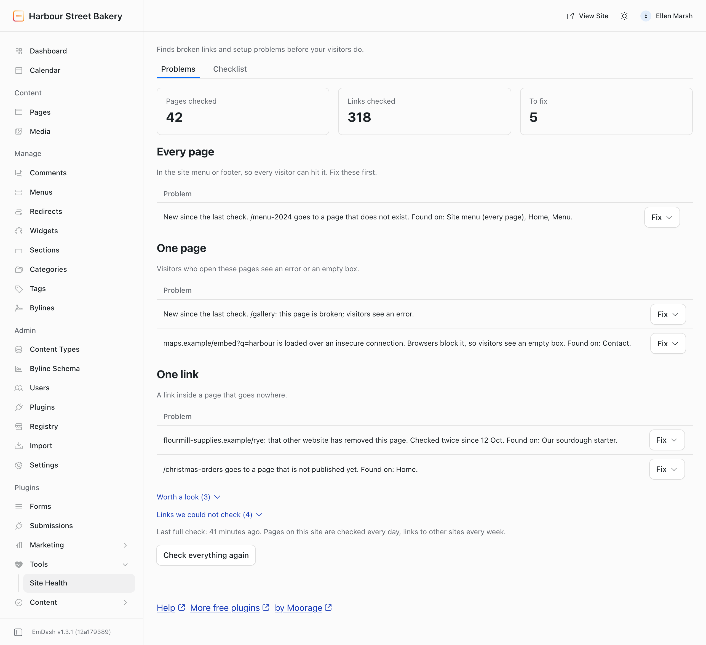

# Site Health & Broken Links for EmDash

Tells you what is broken on your [EmDash](https://emdashcms.com) site before a customer does: a dead link in the menu, a page that shows an error, a map that will not load. It is a broken link checker for your pages, your menu and the links to other sites, with an email when something breaks and a short setup checklist. It runs on any EmDash site, with no account and no key.



## What it does

- **Problems, grouped by how bad.**
  - **Every page:** a broken link in the site menu or footer.
  - **One page:** a page that shows visitors an error, or loads a map, video, script or form over an insecure connection (browsers block those, so visitors see an empty box).
  - **One link:** a link inside a page that goes to a page that does not exist, a page not published yet, or a page another website has removed.

  There is one row per broken address, with the pages it was found on. A row is marked "New since the last check" when it first appeared in the latest check.

- **Fix menu on every row.**
  - **Send visitors to another page:** adds a redirect from the dead address to a page you pick from a list, which fixes it everywhere at once. Admins only, as in EmDash itself.
  - **Edit:** opens the page, with the link named.
  - **Check it again now.**
  - **This is fine, stop checking it.**
- **Two folded lists that never count.**
  - **Worth a look:** links that work but take a detour, and pictures over an insecure connection.
  - **Links we could not check:** sites that turn away automatic checkers, such as LinkedIn and Instagram. These are never called broken.
- **Email.**
  - At once when a page shows an error or a menu link breaks.
  - A weekly list of only what is new.
  - Sent to several addresses, with the site's name first in the subject.
  - Never more than one email a day of each kind.
- **Checklist** (Admins):
  - the site address is set and secure;
  - the insecure address sends visitors to the secure one;
  - the address with and without www;
  - a made-up address shows the "page not found" page;
  - search engines are allowed in;
  - pages can be kept ready for visitors;
  - scheduled tasks are running;
  - email works: who gets it, whether an email service is chosen, and when it last worked, with the test button beside it.
- **Dashboard widget** with the count.

Editors see the links they can fix. Page errors, the Checklist and Options are for Admins.

## What it does not do

- It does not change the links inside your pages. That would need permission to rewrite content; the redirect fixes an address on your own site everywhere instead.
- No score, grade, history, charts or CSV export.
- No speed tests, security headers, certificate expiry or version checks.
- No missing alt text (the SEO plugin does that). It does not check canonical addresses (the SEO plugin does that too).
- It cannot read menus, widget areas or sections directly. Menu and footer links are found on the rendered home page, so they need the site to be public.

## Install

Install from **Plugins** in your EmDash admin, or pin it in code:

```sh
npm install @moorage/plugin-site-health
```

```js
// astro.config.mjs
import siteHealth from "@moorage/plugin-site-health";

emdash({ sandboxed: [siteHealth] });
```

On a site without a sandbox runner (the Workers free plan), list it under `plugins: [siteHealth]` instead. It works the same. Since 0.1.3 the email list and the outside-link choice survive moving the plugin from one list to the other (the check results are rebuilt by the next check); when updating from an earlier version, update first, open the Site Health page once, then move it.

**Emails from a registry install on Cloudflare need EmDash 1.4.0 or later.** On EmDash 1.3, a plugin installed from the EmDash registry (which always runs sandboxed) cannot use the site's email service on Cloudflare: every email fails with "Email is not configured", although the site's own emails work. EmDash 1.4.0 fixes this. From 0.1.6 the Checklist's Email row says so after a test email fails this way.

**On Cloudflare's Workers free plan** each request gets about 10 ms of CPU. EmDash's own saving and publishing already comes close to that, and every plugin run in the site's process adds a little, so a save or publish can now and then fail with "Worker exceeded resource limits"; trying again works. Workers Paid (30 seconds per request) does not have this problem.

Then open **Tools > Site Health** in the admin sidebar.

**Permissions it asks for:**

| Permission                     | Why                                                                 |
| ------------------------------ | ------------------------------------------------------------------- |
| Read content and content types | Finds the links in your pages.                                      |
| Change redirects               | For "Send visitors to another page".                                |
| Fetch any address              | Links to other sites and your own address are not known in advance. |
| Send email                     | Alerts and the test email.                                          |

**It needs EmDash's scheduled tasks.** On Cloudflare that means a Cron Trigger on the Worker. If they are not running, the Checklist says so and gives your web person the steps to copy; the check then moves one step each time the page is opened.

## How it checks

| What                 | How                                                                                                                                                                                                                                                  | How often                                                  |
| -------------------- | ---------------------------------------------------------------------------------------------------------------------------------------------------------------------------------------------------------------------------------------------------- | ---------------------------------------------------------- |
| Your pages           | Reads every entry, a batch each minute. Links to your own site are checked against your pages and redirects, with no fetching.                                                                                                                       | Every day, and a page again when it is saved or published. |
| Your rendered pages  | Opens the home page (for the menu and footer) and then each page, two a minute.                                                                                                                                                                      | Every day.                                                 |
| Links to other sites | Three a minute, on different sites, never one site more than once a minute. Each one says who it is: `EmDash-SiteHealth/0.1 (+your address)`. A link is broken only when the other website says the page is gone on two checks at least a day apart. | Every week, and again a day after a failure.               |
| Checklist            | Up to five requests.                                                                                                                                                                                                                                 | Once a week.                                               |

The numbers on the page are always a finished check. A check that is still running never changes them.

Each run stays within the EmDash sandbox's limits of 10 calls (it makes at most 9) and about 50 ms of CPU. The scheduled task runs every minute.

**If the site cannot open its own pages** (not public yet, bot protection, or a host that blocks a site from fetching itself), it says so in one banner. If your site is in the middle of an update and shows every visitor an error page, it says that instead, and emails at once. Links inside your content are still checked, and anything that needed the live page is listed as "could not check", never as broken.

## FAQ

**Why does a link show under "could not check"?** Some sites refuse automatic checkers, ask them to slow down, or did not answer within 8 seconds. Open it to see for yourself; it is tried again next week.

**Why do links to other sites take a day?** A site that is down for an hour should not send you an alert, so a broken answer is confirmed a day later.

**Who gets the emails?** The first Admin who opens Site Health, plus anyone added under Checklist, Options. An empty list means no email. Your site needs an email service chosen in EmDash (Settings, Email); the Email row on the Checklist says whether it has one, and "Send a test email" checks it now.

**Does it send anything anywhere?** Only to the websites your pages link to (to check them) and the email addresses you list.

**What is the line at the foot of the page?** Only admins see it: "Help · More free plugins · by Moorage", links to the guide on moorage.dev and to more free plugins. Editors never see it. To hide it, switch on "Hide the help line at the foot of this page" under Checklist, Options and press Save.

**Why do the checks and emails use the site's old address?** Plugins keep the site address EmDash had when the server started; Site Health uses it to open your own pages, to tell your links from other sites' and in its emails and instructions. After changing the site's address, restart the site.

## Changelog

- **0.1.0:** first version.

## Develop

```sh
pnpm --filter @moorage/plugin-site-health build
pnpm --filter @moorage/plugin-site-health test      # sandboxed, own pages and other sites simulated
DEMO_SITE_PORT=4402 pnpm --filter demo-site exec playwright test tests/site-health.spec.ts
DEMO_SITE_PORT=4402 DEMO_SITE_SITE_HEALTH=in-process pnpm --filter demo-site exec playwright test tests/site-health.spec.ts
```

The tests never contact a real site.

## Licence

MIT. Copyright 2026 GoSi Tech.
